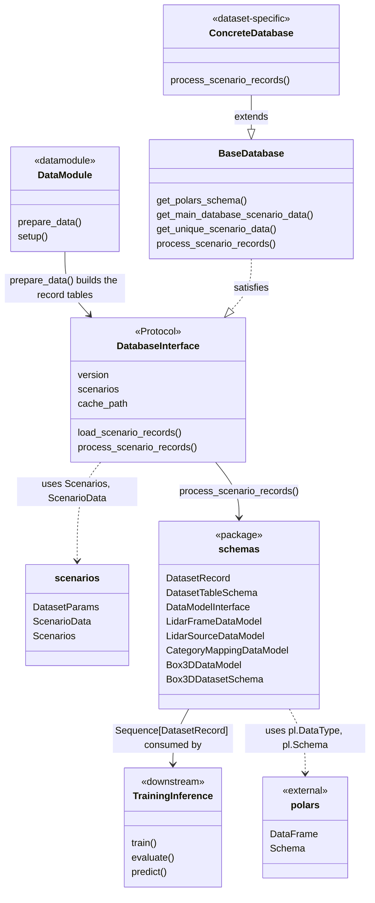

# Database Design

The database module provides a layered architecture for describing annotation databases and generating dataset records. A shared protocol and base class sit at the top, with dataset-family-specific implementations underneath. Scenario metadata (splits, versions, sampling parameters) is modelled as immutable Pydantic objects so that every database instance is fully hashable and cacheable.

## Architecture Overview



## Core Components

### DatabaseInterface

`DatabaseInterface` is the protocol that every database implementation must satisfy. It defines the contract for version metadata, scenario access, and record generation:

```python
class DatabaseInterface(Protocol):
    @property
    def version(self) -> str: ...

    @property
    def scenarios(self) -> MappingProxyType[str, Scenarios]: ...

    def get_unique_scenario_data(self) -> MappingProxyType[str, ScenarioData]: ...
    def load_scenario_records(self) -> Sequence[DatasetRecord]: ...
    def process_scenario_records(self) -> None: ...
```

All concrete databases are accessed through this protocol, ensuring downstream code (training, evaluation) never depends on a specific dataset format.

### BaseDatabase

`BaseDatabase` provides the shared implementation of `DatabaseInterface`. It handles initialization from version and paths, caching directory creation, Polars schema retrieval, and deduplicating scenario data across groups:

```python
class BaseDatabase:
    def __init__(
        self,
        version: str,
        root_path: str,
        cache_path: str,
        cache_file_prefix_name: str,
        num_workers: int,
        vocabulary: LabelVocabulary,
        box3d_pipelines: Sequence[Box3DPipeline],
        lidar_intensity_scale: float,
        lidar_pointcloud_num_features: int,
    ) -> None:
        ...

    def get_polars_schema(self) -> pl.Schema: ...
    def get_unique_scenario_data(self) -> MappingProxyType[str, ScenarioData]: ...
    def process_scenario_records(self) -> None:
        raise NotImplementedError("Subclasses must implement process_scenario_records method!")
```

To add a new dataset family, subclass `BaseDatabase` and implement `process_scenario_records()`. See [T4Dataset](t4dataset.md) for a concrete example.

### Scenarios

The `scenarios` module models scenario metadata as immutable Pydantic objects. `DatasetParams` captures per-dataset preprocessing parameters, `ScenarioData` uniquely identifies a single scenario with its version and sampling settings, and `Scenarios` is the abstract base that concrete implementations extend to parse scenario configs based on a dataset:

```python
class DatasetParams(BaseModel):
    dataset_name: str
    sample_steps: int

class ScenarioData(BaseModel):
    dataset_params: DatasetParams
    scenario_id: str
    scenario_version: str
    vehicle_type: str | None = None
    location: str | None = None

class Scenarios(BaseModel):
    scenario_root_path: Path
    dataset_params: Sequence[DatasetParams]
    scenario_data: Mapping[SplitType, Sequence[ScenarioData]] | None = None

    @model_validator(mode="after")
    def build_scenarios(self) -> Scenarios:
        raise NotImplementedError("Subclasses must implement build_scenarios!")
```

### Label sets, category aliases and dataset options

A dataset may be annotated at a coarser specification than the classes a model trains: an
older annotation specification may label `manmade` for what the trained classes split into
buildings, poles, signs and barriers. A taxonomy declares such coarser labels as `class_sets`,
each a *label set*: a name for at least two of its classes. A fine label mapped to a label set
says that a point belongs to one of the set's classes, but not to which one.

- Its points get the label index `num_classes + k` for the set at position `k`.
- The segmentation head trains them on the summed probability of the set's classes (cross
  entropy of the marginal, also after the voxel reduction of the targets) and leaves them out
  of the Lovasz term.
- Every metric skips them, because their index is outside the class range.

So the dataset supervises exactly what it knows instead of forcing a guess.

Raw category names are shared across datasets, but their meaning is not: `sidewalk` in an
older specification may still contain the curbs, in a newer one not. A dataset's
`DatasetParams.category_aliases` renames such raw names (`sidewalk` to `legacy_sidewalk`) when
its record table is generated. The vocabulary lists the renamed categories as fine names of
their own, and the taxonomy maps them to the class or label set they mean there. A dataset with
aliases therefore needs a vocabulary that lists them.

`DatasetParams` has one more dataset option, `require_semantic_mask`: keep only the samples
whose LiDAR frame has a semantic mask, for a dataset labelled at a lower rate than it was
recorded.

The dataset options and the label sets enter the database hash only when they differ from their
defaults, so the record tables of every other database keep their hash.

### Packed LiDAR frames

A scene may keep the frames of a LiDAR channel, `data/<channel>/*.pcd.bin`, as one
`data/<channel>.pack` file (t4pack v1: every frame compressed on its own with zstd over its
columns, plus a frame index). Packs are written by the data processing tools; autoware-ml only
reads them.

When a scene has a pack, record generation reads its index once and stores the location of every
frame and sweep in `lidar_pointcloud_t4pack_frame`. `lidar_pointcloud_relative_path` keeps the
path of the loose file, so the pack is found next to it. `LoadPointsFromFile` and
`LoadMultiSweepPointsFromFile` choose the file format with `pcd_file_format`, a
`PCDFileFormat` from `autoware_ml.types.dataset`:

| `pcd_file_format` | Reads                                                                         |
| ----------------- | ----------------------------------------------------------------------------- |
| `auto` (default)  | the pack when the record has a pack location, else the `.pcd.bin` file        |
| `bin`             | the `.pcd.bin` file of every frame                                            |
| `t4pack`          | the pack of every frame; fails on a record without a pack location            |

Both formats return the same points. A pack is read one byte range per frame. In a Hydra config:

```yaml
- _target_: autoware_ml.transforms.multi_task.point_cloud.loading.LoadPointsFromFile
  pcd_file_format:
    _target_: autoware_ml.types.dataset.PCDFileFormat
    _args_: [t4pack]
```

See `autoware_ml/databases/t4pack/t4pack.py`.

### Record Generation

There is no separate generation entrypoint. A task config composes its database from the
`database` config group, Hydra instantiates it, and the datamodule builds the record
table of every database that has no cache yet in `prepare_data()`, which Lightning calls once
on the main node before `setup()`:

```python
def prepare_data(self) -> None:
    for database in self.databases():
        database.process_scenario_records()
```

So the first `train` or `test` run over a database generates its records, and later runs load
the cached table. Override the generation parameters from the command line with Hydra syntax:

```bash
autoware-ml train --config-name <task>/<model>/<config> database.num_workers=32
```

The table is written under `cache_root_path`, `AUTOWARE_ML_CACHE_PATH` of `.env` or `.cache` of
the repository root, as `<cache_path>/<cache_file_prefix_name>_<database_hash>.parquet`. The
hash covers the scenario lists and every field that changes the records, so a changed database
writes a new table next to the old one. See [Configuration Guide](../user-guide/configuration.md) for the path keys.

## Extending the Database

| Extension Point      | How                                                                                                          |
| -------------------- | ------------------------------------------------------------------------------------------------------------ |
| New dataset family   | Subclass `BaseDatabase`, implement `process_scenario_records()`, register in a Hydra config                  |
| New scenario format  | Subclass `Scenarios`, implement `build_scenarios()` to parse format-specific YAML                            |
| New schema columns   | See [Dataset Schema](schemas.md)                                                                             |

## Implementation

| Path                                          | Description                                           |
| --------------------------------------------- | ----------------------------------------------------- |
| `autoware_ml/databases/schemas/`              | Dataset schema package — see [schemas.md](schemas.md) |
| `autoware_ml/databases/scenarios.py`          | `ScenarioData`, `DatasetParams`, `Scenarios`          |
| `autoware_ml/databases/database_interface.py` | `DatabaseInterface` protocol                          |
| `autoware_ml/databases/base_database.py`      | Shared `BaseDatabase` implementation                  |
| `autoware_ml/datamodule/data_module.py`       | `prepare_data()` builds the record tables             |
| `autoware_ml/configs/database/`               | Bundled database configs                              |
