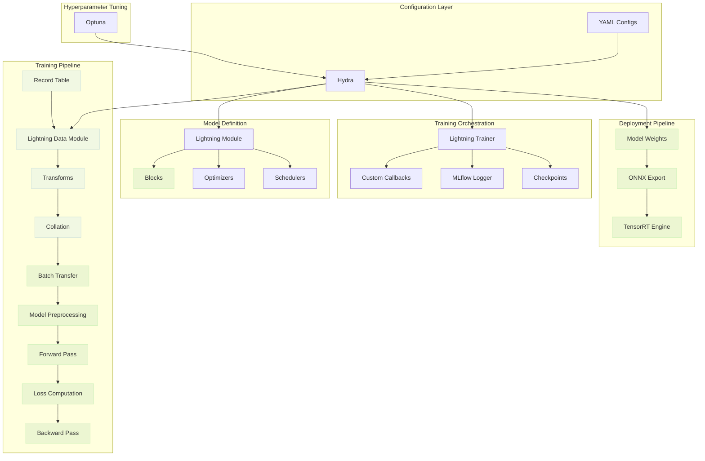

# Framework Design

Autoware-ML is built on a modular architecture that separates concerns into key components including configuration, data handling, model definition, training, and deployment, among others. This design makes it easy to add new models and datasets while reusing common infrastructure.

## Architecture Overview



**Legend:** <span style="display: inline-block; width: 12px; height: 12px; background-color: #42a5f5; border: 1px solid #1976d2; margin-right: 4px; vertical-align: middle;"></span> CPU operations | <span style="display: inline-block; width: 12px; height: 12px; background-color: #66bb6a; border: 1px solid #388e3c; margin-right: 4px; vertical-align: middle;"></span> GPU operations

## Core Components

### Configuration (Hydra)

Everything in Autoware-ML is configured through YAML files processed by [Hydra](https://hydra.cc/). This enables:

- **Hierarchical configs** - Inherit from base configs, override specific values
- **Runtime overrides** - Change any parameter from the command line
- **Automatic instantiation** - `_target_` keys specify Python classes to instantiate via `hydra.utils.instantiate()`

See [Configuration Guide](../user-guide/configuration.md) for full details on Hydra syntax.

### Data Module

The data pipeline reads the record table of a database. A database turns its raw annotations
into one Parquet table with a row per lidar frame, see [Database Design](../databases/design.md).

`DataModule` (extending `LightningDataModule`) builds the datasets of every split from that
table:

- `prepare_data()` generates the record table of every database the splits read, once
- `setup()` splits each table by the scenario lists of its database and builds one dataset per
  dataset source of a split
- every split gets its own dataloader settings (batch size, workers, shuffling, pin_memory)

```python
class DataModule(L.LightningDataModule):
    def __init__(
        self,
        splitter: SplitterInterface,
        sources: Mapping[str, DatasetSource],
        train_dataloader: DataLoaderConfig | None,
        validation_dataloader: DataLoaderConfig | None,
        test_dataloader: DataLoaderConfig | None,
        predict_dataloader: DataLoaderConfig | None,
        train_frame_sampling: FrameSamplingConfig | None,
    ) -> None:
        ...
```

A `DatasetSource` names one database, the dataset of every split it serves, and how many times
its frames appear in one training epoch (`repeat`). A split is served by the sources declaring a
dataset for it, concatenated in declaration order, so several sources mix their corpora. A
dataset reads the database of its source and declares whether the boxes (`det3d_supervised`) and
semantic masks (`seg3d_supervised`) of that corpus supervise the run. A dataset with a task
turned off still serves that task, with an empty box set or ignored point labels, so every
sample of the split collates with the others. Every source reads its labels through the
taxonomies of the run.

The datasets are instantiated by Hydra without records. In `setup()` the datamodule calls
`bind(records)` on the dataset of every source, which returns a copy serving the records of that
database in the split, and concatenates the bound copies of a split in declaration order.

Temporal models that carry a memory across batches train on a `StreamingDataModule`, a `DataModule` that also takes the experiment `seed`. Every dataloader draws from a `GroupStreamingSampler`, which joins the scenes, the training split reshuffling them every epoch from `seed`, and cuts their frames, each scene in time order, into one lane per batch position of every rank. The lanes differ by at most one frame, and a shorter lane ends with a padding slot that repeats its last frame, so every rank runs the same number of batches and every split serves every frame exactly once as a real sample. The batch flags the padding slots in `ModelGTBatch.padding_mask`: a model leaves them out of its loss, and the logged batch size (`num_supervised_samples()`) and every metric suite leave them out. Their frames stay in the eval output, flagged by `is_padding`, so every GPU gathers as many frames. A prediction writer drops them by the mask it gets with the batch. Anything that would reorder the frames is refused: frame sampling, a shuffling dataloader and `trainer.overfit_batches` (shorten a run with `limit_train_batches` / `limit_val_batches` instead). A model config switches to it by composing `/datamodule/streaming@datamodule: default_streaming_datamodule` after its database datamodule. A dataloader of it can augment every frame of a scene alike, see [Stream-consistent augmentation](#stream-consistent-augmentation).

A scene annotated only at its key frames streams at the full lidar rate when its dataset sets `non_key_frames: true`: the records then also hold the frames between the key frames, with their sweeps but no camera frames, no boxes and no masks, and `FrameMetaSample.key_frame` tells them apart. With `sample_steps` above 1 only every `sample_steps`-th key frame keeps its annotations, the other key frames stream like the frames between them, so a fully annotated scene can stream at its lidar rate and be scored at a lower one. `ModelGTBatch.supervised_mask()` leaves them out of the loss like the padding slots, and the metrics score the key frames only. Such a database serves the test and predict splits only: models train and validate on annotated frames, so the datamodule refuses it on the training and validation splits, and no dataset naming its cameras reads it. A model whose losses skip these frames sets `skips_unsupervised_frames`, every other model refuses a batch that holds one outside of prediction.

### Dataset

`BaseDataset` turns one record into a `ModelGTSample` and runs the transforms on it:

```python
class BaseDataset(Dataset):
    def __getitem__(self, index: int) -> ModelGTSample:
        model_gt_sample = self.get_data_sample(index)
        return self.apply_transforms(model_gt_sample)

    @abstractmethod
    def get_data_sample(self, index: int) -> ModelGTSample:
        ...

    def collate_fn(self, batch: Sequence[ModelGTSample]) -> ModelGTBatch:
        ...
```

`T4Dataset` implements it for T4 databases, and `NuScenesDataset` extends it for nuScenes. The
annotations of each task come from a task dataset deriving `BaseDatasetTask`, such as
`Detection3DTask` and `T4Segmentation3DTask`. A dataset config lists its task datasets under
`dataset_tasks`, so one dataset class serves detection, segmentation or both. The dataset config
leaves its transforms required (`???`), and every model sets the pipeline of each split in its
task config.

`get_data_sample()` returns the sensor file paths, calibration and annotations of a record. Point
clouds and images are loaded by the transforms. The collate function stacks the samples into a
typed `ModelGTBatch`.

### Transforms

Transforms are composable data augmentations applied per sample on CPU. Each transform takes a
`ModelGTSample` and returns the updated sample.

```python
class BaseTransform(ABC):
    _required_keys: Sequence[str] = ()

    def __call__(self, model_gt_sample: ModelGTSample) -> ModelGTSample:
        self._validate_required_keys(model_gt_sample)
        if not self._should_apply():
            return self.on_skip(model_gt_sample)
        return self.transform(model_gt_sample)

    @abstractmethod
    def transform(self, model_gt_sample: ModelGTSample) -> ModelGTSample:
        ...

class TransformsCompose:
    def __init__(self, pipeline: Sequence[BaseTransform]):
        self.pipeline = pipeline

    def __call__(self, model_gt_sample: ModelGTSample) -> ModelGTSample:
        for transform in self.pipeline:
            model_gt_sample = transform(model_gt_sample)
        return model_gt_sample
```

Every dataset config carries its own `transforms`, so each split has its own pipeline. The
dataset applies it in `__getitem__()`.

Public transform targets should reference the concrete implementation module, for example
`autoware_ml.transforms.point_cloud.loading.LoadPointsFromFile` or
`autoware_ml.transforms.camera_lidar.geometry.GlobalBEVRandomFlip`. Avoid package-level re-export
layers in `__init__.py`. Imports and Hydra `_target_` paths should point at the implementation
module directly.

#### Stream-consistent augmentation

A temporal model carries a memory from one frame of a scene to the next, so an augmentation that
moves the scene has to be the same in every frame of it. A dataloader of the `StreamingDataModule`
turns this on with one flag, off by default:

```yaml
datamodule:
  train_dataloader:
    stream_consistent_augmentation: true
```

The sampler then hands every frame the seed of its stream, the experiment seed, the epoch and the
scene, and the pipeline seeds a random state from it for every transform that supports it. The
frames of a scene draw the same values in every dataloader worker and on every rank, the next scene
and the same scene in the next epoch draw new ones. The experiment `seed` has to be from 0 to
2**32 - 1 with the flag on.

The flag only changes the transforms that support it. These draw once per scene:

| Transform                  | Alike in every frame of a scene                                    |
| -------------------------- | ------------------------------------------------------------------ |
| `GlobalRotScaleTrans`      | yaw, scale and translation                                         |
| `RandomRotateTargetAngle`  | yaw                                                                |
| `GlobalBEVRandomFlip`      | horizontal and vertical flip                                       |
| `ResizeCropFlipRotImage`   | resize, crop, flip and rotation of every camera                    |
| their `probability`        | whether the transform is applied, decided for the whole scene      |

These draw for every frame on its own, with the flag on as well:

| Transform                       | Drawn per frame                                               |
| ------------------------------- | ------------------------------------------------------------- |
| `CalibrationMisalignment`       | rotation and translation noise of the calibration             |
| `Affine`                        | affine distortion of the images                               |
| `ShuffleCameraOrder`            | order of the cameras                                          |
| `CropAndScale`                  | crop box of every camera                                      |
| `PhotometricDistortion`         | brightness, contrast, saturation and hue                      |
| `RandomJitter`                  | noise of every point                                          |
| `RandomStrengthJitter`          | gamma, scale and shift of the intensity                       |
| `RandomDropout`                 | points dropped                                                |
| `PointsRandomShuffle`           | order of the points                                           |
| `LoadMultiSweepPointsFromFile`  | sweeps picked with a random `selection`                       |
| their `probability`             | whether the transform is applied                              |

Every other transform draws nothing. `CalibrationMisalignment` therefore gives every frame of a
scene another miscalibration, which a real drive does not have. `ShuffleCameraOrder` has to run
after a per-camera `ResizeCropFlipRotImage` in a consistent stream: the image augmentation of a
camera belongs to its position in the camera order, which the shuffle changes from frame to frame.

`ResizeCropFlipRotImage` has `per_camera_augmentation`, true by default, to choose whether the
cameras of one frame draw their own augmentation or share one. It holds with and without the flag:

|                       | `per_camera_augmentation: true`                        | `per_camera_augmentation: false`           |
| --------------------- | ------------------------------------------------------ | ------------------------------------------ |
| **No stream**         | every camera of every frame draws its own              | one draw per frame, shared by its cameras  |
| **Consistent stream** | every camera has its own draw, alike over the scene    | one draw for all cameras of the scene      |

A transform supports it by setting `stream_consistent` and implementing `transform_in_stream`,
which draws from the random state it is given instead of the global one of NumPy:

```python
class MyTransform(BaseTransform):
    stream_consistent = True

    def sample_angle(self, random_state: np.random.RandomState | None = None) -> float:
        return float(random_source(random_state).uniform(-0.3, 0.3))

    def transform(self, model_gt_sample: ModelGTSample) -> ModelGTSample:
        return self.rotate(model_gt_sample, self.sample_angle())

    def transform_in_stream(
        self, model_gt_sample: ModelGTSample, random_state: np.random.RandomState
    ) -> ModelGTSample:
        return self.rotate(model_gt_sample, self.sample_angle(random_state))
```

Every draw has to come from `random_state`, in an order and a number that do not depend on the
sample, so every frame of a scene draws the same values.

### Runtime Data Preprocessing

Runtime preprocessing is a `DataPreprocessor` the model owns. The task config declares it at
the top level as `data_preprocessor`, the builders instantiate it and pass it to the model's
constructor. It runs on the target device after Lightning moves the batch over, and before the
model's `forward()`.

```python
class DataPreprocessor:
    def __init__(self, preprocessor_modules: Sequence[DataPreprocessorModule]) -> None:
        self.preprocessor_modules = tuple(preprocessor_modules)

    def __call__(self, batch: ModelGTBatch, *, is_training: bool) -> ModelBatchInputs:
        batch_inputs = ModelBatchInputs.from_gt_batch(batch)
        for module in self.preprocessor_modules:
            batch_inputs = module(batch_inputs, is_training=is_training)
        return batch_inputs
```

Every module implements `DataPreprocessorModule`: it takes a `ModelBatchInputs` and the keyword
`is_training`, and returns the inputs with the features it computes added or the data it
changes replaced. The model inputs are a typed `ModelBatchInputs`. It holds the collated
`ModelGTBatch` and one field for each kind of preprocessed feature, such as `voxels_data`,
`range_view_data` and `image_data`.

`ModuleBaseModel.on_after_batch_transfer()` applies the preprocessor. Output-side
shaping (e.g., logits -> probabilities, voxel-to-point scatter) lives
**inside the model**, not in a framework pipeline: each model handles it in
its own `forward()`, `compute_metrics()`, `build_eval_output()` and `decode_outputs()`.
Keeping this logic in the model class avoids invisible load-bearing dependencies
between config composition and metric correctness.

### Model

All supported models inherit from `ModuleBaseModel` (extending `LightningModule`),
which provides a standard interface and a set of override hooks for
task-specific behavior:

```python
class ModuleBaseModel(MetricEvalMixin, L.LightningModule, ABC):
    def __init__(
        self,
        log_dict_configs: LogDictConfigs,
        data_preprocessor: DataPreprocessor,
        optimizer: Callable[..., Optimizer] | None = None,
        scheduler: Callable[[Optimizer], LRScheduler] | None = None,
        optimizer_group_overrides: Mapping[str, Mapping[str, Any]] | None = None,
        scheduler_config: Mapping[str, Any] | None = None,
        metrics: Sequence[MetricSuite] | None = None,
    ):
        ...

    def forward(self, multi_task_batch_inputs: ModelBatchInputs) -> ModelOutputs:
        ...  # abstract

    def compute_metrics(
        self, multi_task_batch_inputs: ModelBatchInputs, multi_task_outputs: ModelOutputs
    ) -> Mapping[str, torch.Tensor]:
        ...  # abstract, returns at least "loss"

    def build_eval_output(self, batch: ModelBatchInputs, outputs: ModelOutputs) -> dict[str, Any]:
        ...  # the flat dict the metric suites read, empty by default

    def decode_outputs(
        self, multi_task_batch_inputs: ModelBatchInputs, outputs: ModelOutputs
    ) -> ModelPredictions:
        ...  # abstract, used by the predict step

    def get_log_batch_size(self, multi_task_batch_inputs: ModelBatchInputs) -> int | None:
        ...

    def build_optimizer_groups(self) -> Mapping[str, Sequence[torch.nn.Parameter]]:
        ...

    def build_export_spec(self, multi_task_batch_inputs: ModelBatchInputs) -> ExportSpec:
        ...  # required by deploy

    def build_export_specs(self, multi_task_batch_inputs: ModelBatchInputs) -> dict[str, ExportSpec]:
        ...  # one spec per deployable module, "end_to_end" by default

    def configure_optimizers(self) -> Optimizer | dict[str, Any]:
        ...
```

The base class handles:

- **Unified step logic** - All models share the same training, validation, test, and predict execution path
- **Runtime data preprocessing** - Applies the `DataPreprocessor` of the model after batch transfer
- **Metric logging** - Logs every entry of `compute_metrics()` under the stage prefix per epoch,
  additionally per training step when `log_dict_configs` asks for it, and feeds
  `build_eval_output()` into the attached metric suites at validation and test
- **Predict step** - Runs forward and formats predictions via `decode_outputs()`
- **Export contract** - Every model builds its own export specification from the model inputs
- **Example input** - Collates the first training sample as the example input so the model
  summary reports FLOPs

Models can have **any internal architecture**. `forward()` takes the typed `ModelBatchInputs`
and returns a typed `ModelOutputs` with the head outputs of every task the model predicts.
`decode_outputs()` decodes them into a typed `ModelPredictions`. Both hold one optional field
per task, so a single task model fills one field and a multi task model fills several. The
deployment export cannot trace those dataclasses, so `build_export_spec()` flattens the batch
into the tensor arguments of the exported graph. Specialized models can override hooks such as
`decode_outputs()`, `build_eval_output()`, `get_log_batch_size()`, `build_optimizer_groups()`
or `build_export_spec()` without leaving the shared framework contract.

### Deployment Pipeline

The deployment pipeline exports trained models to production-ready formats:

```mermaid
flowchart LR
    subgraph ONNXExport [ONNX Export]
        Checkpoint[Checkpoint] --> Load[Load Weights]
        Load --> Model[Model Eval Mode]
        Model --> Trace[Trace with Sample]
        Trace --> ONNX[ONNX File]
    end

    subgraph TensorRTBuild [TensorRT Build]
        ONNX --> Parse[Parse ONNX]
        Parse --> Optimize[Build Engine]
        Optimize --> EngineFile[Engine File]
    end

    style Checkpoint fill:#a5d6a7,opacity:0.2,stroke:#05bc23
    style Load fill:#a5d6a7,opacity:0.2,stroke:#05bc23
    style Model fill:#a5d6a7,opacity:0.2,stroke:#05bc23
    style Trace fill:#a5d6a7,opacity:0.2,stroke:#05bc23
    style ONNX fill:#a5d6a7,opacity:0.2,stroke:#05bc23
    style Parse fill:#a5d6a7,opacity:0.2,stroke:#05bc23
    style Optimize fill:#a5d6a7,opacity:0.2,stroke:#05bc23
    style EngineFile fill:#a5d6a7,opacity:0.2,stroke:#05bc23
```



The deployment process:

1. **Load checkpoint** - Instantiates model from config and loads weights from checkpoint
2. **Get input sample** - Uses the predict dataloader to obtain a preprocessed sample for deployment
3. **Resolve export spec** - Builds the effective export module and example inputs through the model's `build_export_spec()` contract
4. **Export to ONNX** - Traces the resolved export module, supporting dynamic shapes for variable input sizes
5. **Build TensorRT engine** - Optimizes the ONNX model for inference on NVIDIA GPUs with configurable optimization profile

Configuration is done through the `deploy` section in task configs.

## Extending the Framework

| Extension Point | How                                                                                           |
| --------------- | --------------------------------------------------------------------------------------------- |
| New model       | Subclass `ModuleBaseModel`, implement `forward()` and `compute_metrics()`, override hooks     |
| New dataset     | Subclass `BaseDatabase` and `BaseDataset`, add task datasets deriving `BaseDatasetTask`       |
| New transform   | Subclass `BaseTransform`, implement `transform()`                                             |
| New task        | Create config in `configs/tasks/`                                                             |

See [Adding Models](../contributing/adding-models.md) for a detailed guide.
