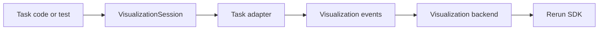

# Visualization Design

Autoware-ML includes an isolated visualization package intended for
prediction preview, calibration debugging, and dataset inspection. The initial
backend target is [Rerun](https://rerun.io/), but the task-facing API is kept
backend-neutral so future backends or offline exporters can reuse the same
task adapters.

## Design Goals

- Keep visualization out of model and transform core logic.
- Make visualization callable from tests, scripts, and CLI commands.
- Reuse one neutral scene-event layer across calibration status, segmentation3d,
  and detection3d.
- Keep the first integration narrow: sample-at-a-time preview rather than
  framework-wide logging during training.

## Layering



### 1. Visualization Session

`autoware_ml.visualization.session.VisualizationSession` is the public entrypoint. It
owns a backend and exposes task-oriented helpers:

- `log_calibration_status(...)`
- `log_segmentation3d(...)`
- `log_segmentation3d_data(...)`
- `log_detection3d(...)`
- `log_detection3d_data(...)`

This keeps later CLI or test integration simple and avoids leaking Rerun calls
into the rest of the framework.

### 2. Task Adapters

Task adapters turn native Autoware-ML data into neutral scene events:

- `visualization/calibration_status.py`
- `visualization/segmentation3d.py`
- `visualization/detection3d.py`

These adapters understand task semantics, for example:

- calibration camera intrinsics and lidar-to-camera transforms
- segmentation point labels and confidences
- detection decoded 3D boxes and class scores
- LiDAR point-cloud intensity and semantic point coloring
- pointwise class probabilities for uncertainty visualization

### 3. Visualization Events

The shared event layer in `visualization/events.py` defines primitives such as:

- `AnnotationContextEvent`
- `ImageEvent`
- `PointCloud3DEvent`
- `Points2DEvent`
- `Boxes3DEvent`
- `Transform3DEvent`
- `PinholeEvent`
- `ScalarEvent`
- `TextEvent`

This is the isolation boundary between task code and any concrete backend.

### 4. Backend

`visualization/rerun_backend.py` is the only place that knows the Rerun SDK.
It converts the neutral events into `rerun.Image`, `rerun.Points3D`,
`rerun.Boxes3D`, `rerun.Transform3D`, and related entities.

There is also a `NoOpVisualizationBackend` for disabled or test-only paths. The
Rerun backend is imported lazily, so the `noop` backend and the smoke tests
built on it stay usable without the Rerun SDK installed.

### Dependency compatibility

`rerun-sdk` 0.23.1 declares `numpy>=1.23`, but its generated `__array__`
implementations forward a `copy` argument that only NumPy 2.0 and later accept.
Under the pinned `numpy==1.26.4` this makes every `AnnotationContext` serialize
to an empty list, and because Rerun reports the failure as a warning rather than
an exception, class legends disappear from the viewer while the recording still
looks healthy.

`rerun_backend.py` therefore patches `rerun.datatypes.ClassId.__array__` to drop
the keyword when it is `None`, which restores NumPy 1.x support and leaves
NumPy 2.x behaviour untouched. Backend startup then logs a probe legend and
raises if it still serializes empty, so an incompatible dependency bump fails
loudly instead of quietly dropping every legend. Remove the patch once the
repository moves to NumPy 2.x or a Rerun release that fixes the conversion.

### Class name resolution

Legends and per-instance labels read as class names rather than integer ids
because the preview takes them from the taxonomy of the database the split
reads: `taxonomy.segmentation3d.class_names` for point labels, with its
`ignore_index` drawn as unlabelled, and `taxonomy.detection3d.class_names` for
boxes. Every source of a split shares one taxonomy, so one lookup covers the
whole split. `visualization.segmentation3d_class_names`,
`visualization.detection3d_class_names` and `visualization.class_names`
override it.

When no names reach an adapter, `format_class_label` falls back to the
stringified class id.

## Task Coverage

### Calibration Status

The initial calibration adapter can log:

- camera intrinsics
- lidar-to-camera extrinsics
- raw camera image
- projected lidar points overlaid on the image plane
- optional fused image preview
- optional 3D lidar points
- predicted and ground-truth calibration status
- prediction confidence and a readable status summary

The adapter takes the lidar-to-camera transform and the intrinsics of the shown
image as plain matrices. The calibration pipelines undistort every image before
any other transform, so a pinhole projection with those intrinsics places the
lidar points exactly where the fused depth channel puts them.

### Segmentation 3D

The segmentation adapter can log:

- semantic class legend
- point cloud positions
- predicted semantic labels as per-point colors
- optional ground-truth labels
- sample metadata and point counts
- optional mean confidence from `pred_probs`
- pointwise normalized entropy computed from `pred_probs`
  (`-sum(p * log(p)) / log(num_classes)`)
- selectable point coloring: semantic labels, LiDAR intensity, or a solid color

This matches the segmentation prediction contract, `Segmentation3DPredictions`,
which carries `pred_labels` and `pred_probs` for every scored point.

### Combined Detection and Segmentation

A combined detection and segmentation sample is logged below one `scene`
hierarchy. The Rerun blueprint presents ground truth and prediction side by
side, with the matching detection boxes overlaid on each point cloud.

The explicit scene layout contains:

- a **Semantic** comparison with GT and predicted pointwise classes
- an **Intensity** comparison using normalized LiDAR return intensity
- a **Geometry** comparison with a neutral point color
- an **Uncertainty** comparison between prediction entropy and predicted semantics
- a **Cameras** tab for the image streams, while every 3D comparison also
  contains optional calibrated camera frustums and image planes
- compact 3D IoU quality and match-count plots below GT/PD detection comparisons

The three point-cloud tabs make the coloring mode selectable in the viewer.
The session's `point_color_mode` only chooses which one is initially active.

Every scene view also lists `scene/meta/extent`, two invisible corner points
spanning the LiDAR points and every GT and predicted box of the frame. Rerun
fits the initial eye of a 3D view to the bounds of what that view shows, so
without the shared extent the GT and prediction views would start from slightly
different eyes whenever only one of them shows a box that sticks out of the
point cloud.

### Synced comparison page

Rerun keeps one eye per 3D view and offers no way to link two views, so the
prediction and comparison views of the layout above drift apart as soon as one
of them is rotated. `--sync-views` therefore serves a second page, by default
on port `9091`, that keeps both sides on one eye:

- The page embeds two complete Rerun web viewers in two same-origin frames,
  served through `visualization/synced_viewer.py`, which proxies the viewer
  bundle from the Rerun web server and exposes the viewer handle on its page.
  Both frames connect to the same gRPC stream as the regular page.
- `build_synced_scene_layouts` derives one full-size scene view per side and
  variant from the same entity paths as the regular layout: the prediction on
  the left, and GT, intensity, entropy, or probability on the right, each with
  camera projections off or on. The backend saves every variant as a blueprint
  file and publishes a manifest; the page loads the selected variant into each
  frame through the viewer handle.
- All variants of a side share one `ViewSpec.identity`, which the Rerun backend
  turns into a stable view id. Rerun keys the viewer state, including the eye,
  by that id, so switching the comparison or the camera projections keeps the
  current viewpoint instead of resetting it.
- The page mirrors pointer, wheel, and keyboard events from either frame into
  the other. Because both sides have the same structure, the same statistics
  row, and the same shared extent, identical input produces identical eyes.
- The page hides the viewer panels and drives the frame cursor and playback of
  both viewers from its own toolbar. The viewer's graphics switches, such as
  `?renderer=webgl`, are passed from the page address to both embedded viewers.
- A poll follows the viewers so that scrubbing inside one of them moves the
  page too. Because `set_time_for_timeline` is applied asynchronously, the poll
  that follows a write still reports the previous frame, so the page keeps a
  short grace period after every write and additionally requires both viewers
  to report the same new frame on two consecutive polls before it follows them.
  Without that, a manual step read its own stale frame back and jumped forward
  again. Stepping by hand also pauses playback, so a viewer that is still
  following an incoming recording cannot pull the timeline along.

Selection and double-click focus act on whatever entity is under the cursor on
each side, so they are the one interaction that can differ between the sides;
the toolbar's **Reload layout** button reapplies the layouts, and the time
controls resynchronize the frame cursor. The page depends on the line of the
Rerun 0.23.1 viewer page that creates the viewer handle; the proxy fails with
HTTP 502 and a log message if a different viewer bundle no longer contains it.

### Detection 3D

The detection adapter can log:

- semantic class legend
- optional lidar points
- decoded predicted 3D boxes
- optional ground-truth boxes
- class-colored boxes with class/score labels
- sample metadata and prediction/ground-truth counts
- the same point-cloud color modes, including LiDAR intensity from column 4
- same-class, yaw-aware 3D IoU matching at threshold 0.5, with per-frame
  true-positive, false-positive, false-negative, precision, recall, and mean
  matched-IoU scalars
- threshold-independent mean-best-GT and frame-maximum IoU scalars, so near
  misses remain visible even when no prediction reaches the matching threshold
- predicted and ground-truth boxes projected onto every camera image as
  class-colored wireframes, with edges behind the image plane dropped

Detection and segmentation use sibling `scene/prediction` and
`scene/ground_truth` entities. A frame with no detection annotations remains a
segmentation-only preview; no synthetic detection objects are created.

### Camera and timing behavior

Cameras are read from the untransformed sample of the dataset, whose
`image_samples` list the image file and the calibration of every camera of the
record at the sample time. Availability is therefore a property of the record
table, not of the task: the segmentation and detection adapters project their
own layers onto every camera in both data and prediction mode, segmentation as
class-colored points and detection as box wireframes, each for ground truth and
prediction.

Each available camera is logged as a transform, pinhole calibration, and image.
The Rerun blueprint places the camera frustums in the same 3D scene as the
LiDAR points and boxes, enabling live 3D camera views and projection inspection.
The backend JPEG-encodes RGB camera frames at quality 95 and broadcasts constant
point radii instead of repeating them per point. These transport optimizations
preserve scene geometry and calibration while keeping 10 Hz recordings usable
over an SSH tunnel.
Prediction box labels are visible by default and contain the class name and
confidence score. They can still be hidden dynamically with Rerun's **Show
labels** property when a dense set of proposals obscures the point cloud.
When calibrated cameras are present, every 3D comparison contains a prominent
**Camera projections OFF** / **Camera projections ON** tab switch. Switching
tabs immediately hides or shows the complete camera subtree, including both
frustums and projected image planes, without restarting inference. Rerun's eye
control beside the `cameras` subtree remains available for per-view adjustment.
`VisualizationSessionConfig.camera_frustums_visible` chooses the initially
active switch position. Pure LiDAR previews do not show the switch and keep the
Blueprint panel collapsed.
Every explicit 3D view uses `scene` as its origin. Automatic views are disabled,
and the Selection and Time panels start collapsed, so a root `/` text view or
stream is not shown in the working layout. The Time panel can be expanded when
the 10 Hz timeline needs to be scrubbed.
Camera overlays are pointwise LiDAR segmentation only; camera/pixel
segmentation is outside this scope.

Detection statistics are rendered as both line and point series. Point markers
keep a single GT keyframe visible and expose its exact value on hover. A
cursor-relative ±10-frame query window keeps the plot focused on the surrounding
GT anchors. Loading additional GT anchors extends the same plots into normal
time-series curves; frames without ground truth do not fabricate
statistics. The statistics row receives one third of the comparison height so
its axes and markers remain readable without displacing the primary point-cloud
views. Match-count axes auto-scale as later GT anchors add larger values, without
republishing the blueprint or resetting interactive camera visibility.

Before each timeline step, the dynamic LiDAR, prediction, ground-truth, camera,
and metadata entities are cleared recursively, so points from previous frames
cannot accumulate. Detection metrics retain their timestamped history for the
plots.

The point color mode accepts `semantic` (default), `intensity`, or `solid`. For
`intensity`, the fourth point feature is normalized per frame and rendered with
the shared scalar heatmap.

The detection adapter reads the `bboxes_3d` / `scores_3d` / `labels_3d` fields
of `Detection3DSamplePredictions`, and also accepts the `bboxes` / `scores` /
`labels` key set.

## Current Integration

Visualization is wired into a dedicated CLI preview command:

```bash
autoware-ml visualize \
    --config-name <task>/<model>/<database>/<config> \
    --weights <path/to/model.ckpt> \
    --mode predictions \
    --split test \
    --sample-index 0 \
    --max-samples 1 \
    --point-color-mode semantic
```

`autoware_ml/visualization/preview.py` drives it:

1. Builds the datamodule from the config, prepares the record tables when they
   are missing, and sets up the selected split.
2. With `--weights`, builds the model like `autoware-ml test` and loads the
   checkpoints into it.
3. For every sample, locates it in the split, collates the transformed
   `ModelGTSample` with the dataset's own `collate_fn`, and keeps the
   untransformed sample for its camera files and timestamps.
4. With a model, moves the batch through `transfer_batch_to_device`,
   `on_after_batch_transfer` and `predict_step`, so the predictions come from
   the model's own preprocessing and decoding. Every 3D layer of a prediction
   preview reads the preprocessed batch, which is the one the predictions are
   aligned with.
5. Logs the tasks the sample carries through `VisualizationSession`.

Segmentation predictions are aligned with the points by the head that made
them: a voxel head labels the current-frame points that fall inside the voxel
grid, and a point head labels every point. The preview picks whichever matches
the number of predicted labels and refuses a sample where neither does.
Ground truth is shown only for the tasks the source is supervised on
(`det3d_supervised`, `seg3d_supervised`), so an unsupervised corpus never shows
its placeholder labels.

When no weights are provided, the same command previews the transformed data of
the split without running prediction.

## Recommended Usage Pattern

A call site builds a session from its config and logs one frame at a time:

```python
from autoware_ml.visualization.contracts import VisualizationSessionConfig
from autoware_ml.visualization.session import VisualizationSession

session = VisualizationSession.from_config(
    VisualizationSessionConfig(
        backend="rerun",
        recording_id="calibration-debug",
        web_port=9090,
        grpc_port=9876,
    )
)
session.begin_frame(sample_index)
session.log_calibration_status(lidar_to_camera=..., image_from_camera=..., image=...)
```

That keeps the dependency on Rerun confined to one backend module. Use
`rerun` for browser-based Docker workflows, and `noop` for smoke tests that
only validate the preview pipeline.
